# maskflow-agent: PII guard for Claude Code

Use Claude Code on production data without Indian PII reaching the model.

A typical debugging session in a fintech, lending or health codebase looks
like: *"why is KYC failing for this user?"* → the agent runs `psql -c
"select * from kyc where ..."` → the rows hold an Aadhaar number, PAN,
mobile and bank account → all of it goes into the model's context.

`maskflow-agent` puts MaskFlow between Claude Code's tools and the model:



- **Every tool result is masked before the model sees it.** Shell output,
  file reads, searches, web fetches and MCP results. Aadhaar, PAN, UPI IDs,
  mobiles, bank accounts, names, ... become `<AADHAAR_1>`, `<PAN_3>`,
  `<INDIAN_MOBILE_2>`. The same value always gets the same placeholder in a
  session.
- **The agent can still act on a specific record.** In allowlisted
  database/kubectl commands the placeholders are swapped for the real values
  *when the command runs*, in a separate process. So
  `sqlite3 kyc.db "UPDATE kyc SET status='ok' WHERE pan='<PAN_3>'"` updates
  the right row, and the model never sees the PAN.
- **The transcript on disk, the permission prompt and Claude Code's logs only
  ever see placeholders.**

## Setup

```bash
pip install maskflow-agent          # or: pip install 'maskflow-cli[agent]'
python -m spacy download en_core_web_sm   # names/addresses; IDs work without it

cd your-project
maskflow-agent install              # writes .claude/settings.json (commit it to share)
maskflow-agent doctor               # proves it end to end with synthetic canaries
```

**Or, as a Claude Code plugin.** No `pip install`, and no edits to your
`settings.json`:

```
/plugin marketplace add maskflow/maskflow
/plugin install maskflow-agent@maskflow
```

From a shell, `claude plugin marketplace add maskflow/maskflow --sparse
.claude-plugin plugins` checks out only the plugin, not the whole repository (`--sparse` needs git 2.25 or newer).

If the `maskflow/maskflow` shorthand fails with "Could not read from remote
repository", Claude Code is cloning over SSH and your machine isn't set up
for GitHub SSH. Use the HTTPS URL instead:
`/plugin marketplace add https://github.com/maskflow/maskflow.git`.

If [uv](https://docs.astral.sh/uv/) is installed, the plugin's first session
builds its own environment (the pinned `maskflow-agent` plus the spaCy model).
That took about a minute, once, in testing; later sessions start in seconds.
Without uv, `pip install maskflow-agent` and the plugin uses it from your
PATH. Until one of these exists, every tool call is denied. Use the plugin
**or** `maskflow-agent install`, not both: `doctor` flags hooks installed
twice.

`install` also loads the masking engine once, so your first session doesn't
pay the cold start (about 30 s on a fresh install while Python compiles and
spaCy loads; about 2 s after that). Skip it with `--no-warm-up`.

`install --scope local` writes `.claude/settings.local.json` (just you);
`--scope user` writes `~/.claude/settings.json` (every project).
`maskflow-agent uninstall` removes exactly the guard's hooks and nothing else.

Requirements: Claude Code **2.1.295+** (needed to block a tool when the guard
can't run), macOS or Linux (Windows isn't supported in 0.1).

## How it works

| Hook | What it does |
|---|---|
| `SessionStart` | Starts one masking daemon per session. It keeps the value ↔ placeholder mapping **in memory only**. Tells the model what placeholders are. |
| `PreToolUse` (every tool) | Makes sure the daemon is alive, and restarts it if not. Runs with `onFailure: block`, so **a tool never runs while its output can't be masked.** Wraps allowlisted commands that use placeholders. Refuses file edits that contain placeholders. |
| `PostToolUse` (every tool) | Replaces the tool result with its masked version, keeping the result's structure. |
| `UserPromptSubmit` | Warns when *you* type personal data. Prompts can't be masked, only warned about or blocked. |
| `SessionEnd` | Writes a counts-only summary to `~/.maskflow/agent/sessions/` and stops the daemon. |

A value identified once is masked everywhere after that, whatever its
context. A mobile seen under a `mobile` CSV header is also masked in a bare
`grep` hit or a headerless `sqlite3` row later.

### Placeholders → real values: when it does and doesn't happen

Placeholders are restored **only** when every command in the Bash command
line starts with an allowlisted program:
`psql mysql mariadb sqlite3 duckdb mongosh mongo redis-cli clickhouse-client cqlsh` and
`kubectl exec`.

Restoration does not happen:

- for anything else (`curl …/<PAN_3>` sends the literal text `<PAN_3>`).
- when the command line has a part that can't be read with certainty:
  `$(…)`, backticks, process substitution or unbalanced quotes.
- in `Write` / `Edit` / `MultiEdit` / `NotebookEdit`. These are refused
  outright, because writing a placeholder over real data would corrupt it.
  The agent is told to edit around them or ask you.

The hook rewrites the command to `python -m maskflow_agent exec --session …
--ticket … -- '<command with placeholders>'`. The ticket is single-use,
bound to that exact command text, and issued only by the hook. Without it,
the daemon refuses to restore anything. That covers both the model calling
the wrapper itself and anything talking to the daemon's socket directly.

**Permissions.** The guard never grants more than you already allowed. A
wrapped command is auto-approved only if *your* allow rules in
`settings.json` cover the original command. A matching deny rule still
denies, and a matching ask rule still asks. Otherwise Claude Code's normal
flow (prompt or auto mode) judges the wrapped command. Hooks can't see the
`--allowedTools` CLI flag, so put allow rules for wrapped commands in a
settings file.

### Configuration

`.claude/maskflow-agent.json` (or `~/.maskflow/agent/config.json`):

```json
{
  "unmask_allow_extra": ["my-db-cli"],
  "prompt_mode": "warn"
}
```

`unmask_allow` replaces the default allowlist instead of extending it.
`prompt_mode` is `warn` (default), `block` or `off`.

## Measured

- Real `claude -p` sessions on a synthetic KYC table: the agent read a CSV,
  updated the right row with `WHERE pan='<PAN_4>'`, and read it back.
  **0** of 20 synthetic identifiers appeared in the session transcript.
- Overhead: about **65 ms per hook** (p50, Apple M-series). That is mostly
  Python start-up plus one local socket round trip, so about 130 ms per tool
  call. A 200-row CSV result takes about 350 ms to mask.

## Other agents

Claude Code is the reference integration. The guard also runs inside other
agents' hook systems. How much it can protect depends on what each agent's
hooks are allowed to do:

| Agent | Status | How the guard works there |
|---|---|---|
| Claude Code | verified | Every tool result is masked after it runs. |
| GitHub Copilot CLI and cloud agent | experimental | Every tool result is masked after it runs (`postToolUse` → `modifiedResult`). |
| VS Code agent mode (Copilot) | experimental | **Wrap mode** (see below). VS Code's hooks can't replace a tool result. |
| Cursor (desktop and CLI) | experimental | **Wrap mode**. MCP results are masked after the call. Reads and Tab completion are gated on file content. |

*Experimental* means the adapter was built from the agent's hook
documentation and tested against those payload shapes, but hasn't yet passed
a live session test. `maskflow-agent install` and `doctor` print the status.

**Wrap mode** is for agents whose hooks can rewrite a tool call before it
runs but can't change its result:

- Every shell command is rewritten to run inside `maskflow-agent exec
  --mask-only`, which masks its output and restores nothing.
- Allowlisted commands containing placeholders still get the run-time
  restore.
- The agent's built-in search is refused, and so is a built-in file read
  when the file holds personal data. Both refusals tell the agent to use
  the shell instead, where the output is masked.
- MCP tools are refused, with a pointer to the `maskflow-mcp` proxy, which
  masks MCP results itself.

### GitHub Copilot (CLI, cloud agent, VS Code)

```bash
maskflow-agent install --agent copilot               # .github/hooks/maskflow-agent.json
maskflow-agent install --agent copilot --scope user  # ~/.copilot/hooks/
maskflow-agent install --agent copilot --portable    # runs `maskflow-agent` from PATH
```

All three harnesses read the same file. The guard tells them apart by the
payload: Copilot CLI sends camelCase fields, VS Code its own snake_case
format. For the **cloud agent**, commit a `--portable` file and install the
package in `.github/workflows/copilot-setup-steps.yml`
(`pip install maskflow-agent`). If the package is missing, the before-tool
hook fails, and Copilot then refuses every tool call.

Copilot-specific limits:

- Copilot passes the **original** result through when an after-tool hook
  **times out** or exits non-zero. The installed timeout is 180 s, and the
  hook never exits non-zero.
- A **failed** tool's error text goes to `postToolUseFailure`, which can't
  replace it.
- Copilot discards a config hook's output for `userPromptSubmitted`, so
  personal data in prompts gets no warning in the CLI. VS Code shows the
  warning.
- In VS Code wrap mode, a background terminal command's output appears only
  when the command exits.

### Cursor

```bash
maskflow-agent install --agent cursor                # .cursor/hooks.json (merged, other hooks kept)
maskflow-agent install --agent cursor --scope user   # ~/.cursor/hooks.json
```

Cursor's hooks can replace a tool result only for MCP tools, so Cursor runs
in wrap mode:

- `Shell` commands run through the mask-only wrapper.
- `Grep` and semantic search are refused, with a hint to use `rg`.
- `beforeReadFile` refuses a file holding personal data. This covers the
  agent's reads and @-attached files.
- `beforeTabFileRead` does the same for Tab completion, which also sends
  file content to a model.
- MCP results are masked after the call.

The before-hooks are installed with `failClosed: true`, so a crash or a
timeout blocks the action instead of letting it through. Prompts holding
personal data get a warning (`prompt_mode: block` refuses them).

Cursor-specific limits:

- Cursor doesn't document whether its CLI runs every hook. Only
  `workspaceOpen` is documented for the CLI.
- If Cursor's shell sandbox blocks the wrapper's local socket, wrapped
  commands are **refused**. They don't run unmasked. Not yet tested live.

## Limits

- **Threat model: accidental exposure, not a malicious agent.** An agent
  with shell access running as you can always reach the data some other way
  (for example `psql` with base64-encoded output, which isn't recognised as
  PII). Use read-only database roles and Claude Code permissions for that.
  The guard keeps routine debugging from shipping customer data to a model.
- **Detection is MaskFlow's.** A value seen only once, with no context and
  no checksum (a bare 10-digit number in a headerless row), can be missed.
  See the published IndiaPII benchmarks for per-entity accuracy.
- **Telemetry.** If you export Claude Code OpenTelemetry tool spans, they
  record the *original* tool output before hooks run. Commands wrapped for
  restoration are masked before Claude Code sees them; other tool output
  isn't.
- **A post-tool hook that crashes outright** (not an error inside it, which
  withholds the output) can't stop Claude Code from using the original
  output. The hook is a small standard-library client with a catch-all for
  that reason. `maskflow-agent doctor` tests this path.
- **`--resume` starts a new mapping.** Placeholders from before the resume
  can't be restored. New values never reuse their names: the restarted
  daemon reserves every placeholder already in the transcript.
- **Other agents** have narrower coverage than Claude Code. See
  [Other agents](#other-agents).
